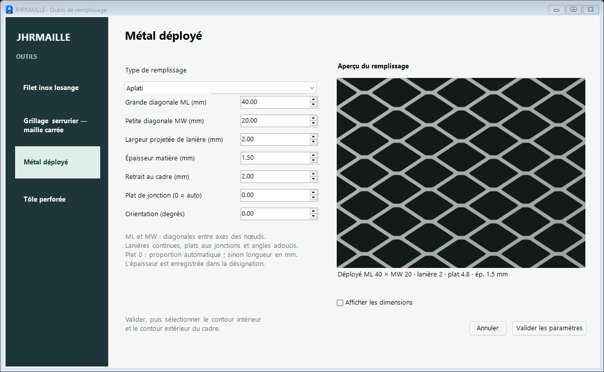
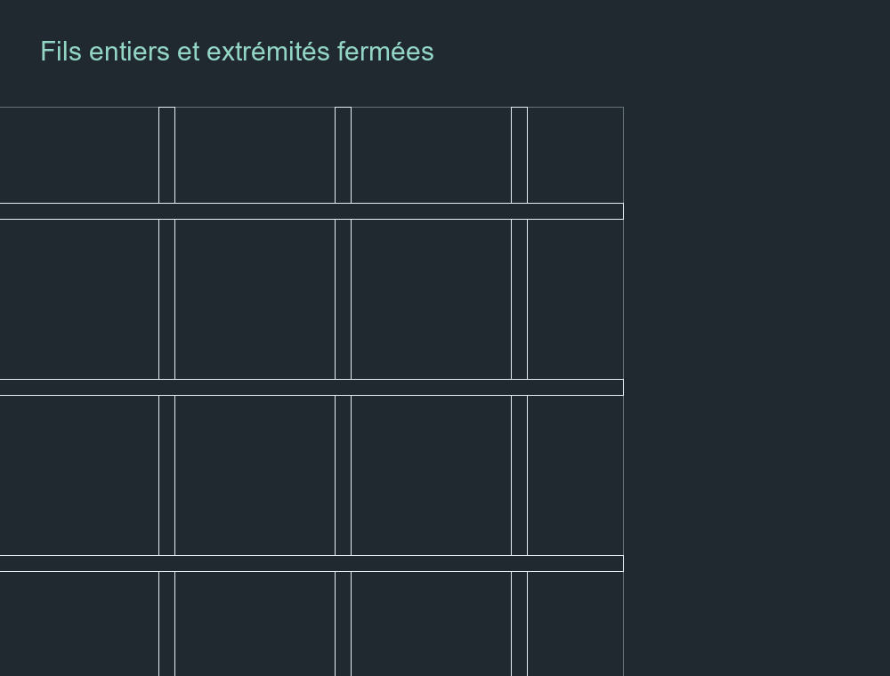
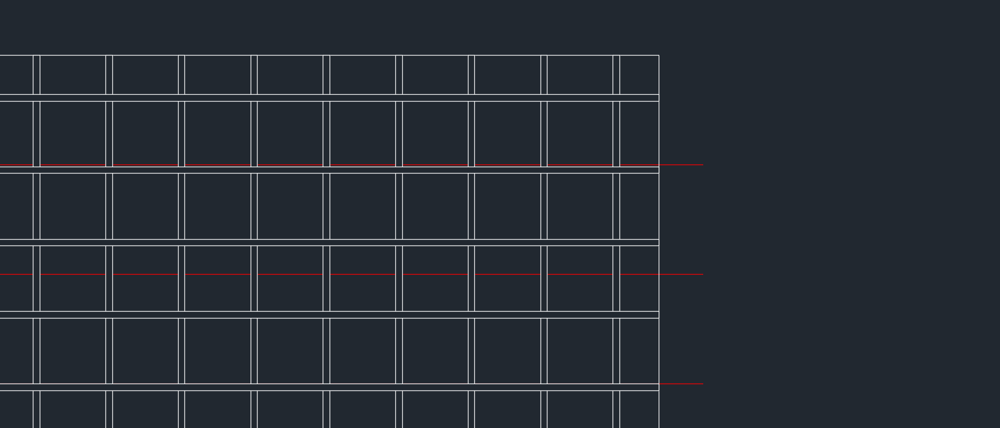

# JHRMAILLE 1.3.3 — panneaux de remplissage en 2D

Commande AutoLISP avec une interface commune pour créer des panneaux : **filet inox losange**, **grillage serrurier à maille carrée**, **métal déployé** et **tôle perforée**. Chaque outil possède ses réglages et son aperçu. Le filet conserve les références Jakob Webnet et son laçage adapté au cadre.

## Installation

Télécharger le dossier complet **JHRMaille2D** du dépôt, ou l’archive du dépôt : le LISP seul ne contient pas l’interface. Les deux fichiers nécessaires sont `JHR_Maille_2D.lsp` et `JhrMailleUi_v1_3_3r1.dll`.

1. Dans AutoCAD pour Windows, charger `JHR_Maille_2D.lsp` avec **APPLOAD**.
2. Charger `JhrMailleUi_v1_3_3r1.dll` avec **NETLOAD**. Cette étape n’est pas nécessaire si le dossier est déjà dans les chemins de recherche et que le LISP trouve la DLL automatiquement.
3. Respecter les règles de sécurité de l’installation. L’outil ne modifie pas SECURELOAD ou TRUSTEDPATHS.
4. Lancer **JHRMAILLEPARAM** pour vérifier que la fenêtre s’ouvre, puis **JHRMAILLE** pour créer un panneau.

La DLL est compilée et testée pour **AutoCAD / Advance Steel 2027, Windows 64 bits, .NET 10**. Sur une autre version, utiliser **JHRMAILLECLI** et **JHRMAILLEPARAMCLI**, ou recompiler l’interface avec le SDK correspondant. La compatibilité ARES, Mac et autres moteurs LISP n’est pas validée.

## Navigation entre les outils

La colonne à gauche donne accès aux quatre outils. Passer d’un outil à l’autre conserve les valeurs saisies sur chaque page. La validation mémorise le choix pour cette session et crée uniquement le panneau de l’outil sélectionné. **Annuler, Échap et la croix** abandonnent toutes les modifications de la fenêtre.

| Outil | Réglages | Sélection |
|---|---|---|
| Filet inox losange | Catalogue Jakob ou saisie libre, câble, diagonales, laçage | Contour intérieur, puis extérieur du cadre |
| Grillage serrurier | Ouverture libre carrée, diamètre du fil, retrait, orientation, mode de contours | Un contour ou deux contours |
| Métal déployé | ML, MW, largeur projetée de lanière, épaisseur, aplati / relief | Contour intérieur, puis extérieur du cadre |
| Tôle perforée | Ø / côté des trous, entraxe, épaisseur, disposition, bordure pleine | Contour intérieur, puis extérieur du cadre |

L’aperçu montre un détail du matériau. Le panneau entier et la découpe au cadre sont calculés après sélection dans AutoCAD. Pour le grillage, le mode de traits cachés agit sur le dessin final ; l’aperçu de détail reste celui des fils soudés.

## Dessiner un panneau

1. Travailler en **millimètres à 1:1**, dans l’espace objet.
2. Préparer une ou deux polylignes 2D **LWPOLYLINE fermées**, suivant l’outil et le mode. Avec deux contours : intérieur puis extérieur, coplanaires ; le second doit entourer strictement le premier, sans croisement ni contact.
3. Choisir le calque du panneau, puis lancer **JHRMAILLE**.
4. Choisir l’outil à gauche et ses dimensions. Pour le filet inox, choisir une référence Jakob ou **Personnalisée · saisie libre**.
5. Régler le retrait et l’orientation. Pour le filet, régler aussi le laçage et les angles. L’aperçu se met à jour immédiatement.
6. Cliquer sur **Valider les paramètres**, puis suivre la sélection : un contour en mode grillage à un contour ; sinon **intérieur**, puis **extérieur**.

Le résultat est un **panneau dans un bloc statique**, placé sur le calque courant. Son contenu est sur le **calque 0, couleur et épaisseur DuCalque**. Les contours sources sont conservés. Une annulation AutoCAD retire l’ensemble de la création lorsque ANNULER est activé.

Les nouveaux blocs commencent par `PANNEAU_FILET_INOX_`, `PANNEAU_GRILLAGE_CARRE_`, `PANNEAU_METAL_DEPLOYE_` ou `PANNEAU_TOLE_PERFOREE_`, puis **largeur × hauteur en mm** et un numéro unique. Exemple : `PANNEAU_GRILLAGE_CARRE_596x596_1`.

Pour le grillage, le déployé et la tôle perforée, ces dimensions sont l’encombrement X/Y du contour de découpe **après retrait**, arrondi à 0,01 mm. Un contour de 600 × 600 mm avec 2 mm de retrait donne 596 × 596 mm. Pour le filet lacé, le nom indique l’encombrement du contour extérieur du cadre. Sur une forme inclinée, les dimensions indiquent son rectangle d’encombrement dans le dessin, pas les longueurs des côtés inclinés. Les blocs déjà créés ne sont ni renommés ni modifiés automatiquement.

**Annuler, Échap et la croix** ferment la fenêtre sans modifier les réglages ni créer d’objet. JHRMAILLEPARAM ouvre la même fenêtre et mémorise uniquement les réglages de la session. Le rechargement du LISP ne transforme pas les panneaux déjà créés : régénérer un remplissage à partir des contours conservés.

## Grillage serrurier : un ou deux contours

Le grillage est **soudé à fils droits**. La dimension saisie est l’ouverture libre entre les bords des fils ; **entraxe = ouverture libre + diamètre**. Exemple : ouverture 30 mm et fil Ø3 mm → entraxe 33 mm. Les fils sont dessinés par **deux bords géométriques sans largeur de polyligne**. Les fils horizontaux passent devant ; les deux bords des verticaux s’interrompent à chaque croisement.

La trame est centrée en conservant le pas et le diamètre. Sur un rectangle orienté selon la trame, les rives finissent dans une ouverture : aucun rond coupé dans sa longueur. Les bouts des fils sont fermés par un trait de coupe suivant l’angle réel du contour, y compris en trapèze et sur un contour concave. Un panneau plus petit que le diamètre du fil est refusé.

Choisir dans **Sélection du grillage soudé** :

- **Un contour · limite du panneau** : sélectionner une seule polyligne fermée. Les fils sont découpés sur cette limite.
- **Deux contours · fils visibles** : sélectionner le bord intérieur du cadre, puis le bord extérieur où le grillage s’arrête. Tous les fils restent visibles.
- **Deux contours · derrière le cadre en caché** : mêmes sélections ; la partie entre les deux contours est en traits cachés. La partie dans l’ouverture reste en traits continus.

Pour finir exactement sur la limite choisie, régler **Retrait au cadre = 0**. Un retrait positif réduit le panneau à l’intérieur de cette limite. Les polylignes trapézoïdales et les contours concaves sont aussi découpés ; un retrait qui divise le panneau est refusé.

Les traits cachés utilisent le type de ligne local **JHR_CACHE**, motif 4 mm / espace 2 mm. Seul leur type de ligne est fixé ; couleur et épaisseur restent DuCalque. L’affichage imprimé dépend aussi des réglages de type de ligne de la présentation et de la fenêtre. L’outil ne change pas LTSCALE, PSLTSCALE ou les présentations.

### Masquage arrière-plan du grillage

Dans la page **Grillage serrurier — maille carrée**, cocher **Masquage arrière-plan**, puis choisir :

- **Sous les fils · ouvertures transparentes** : des WIPEOUT suivent uniquement la matière des ronds. Les objets derrière sont cachés sous les fils et restent visibles dans les ouvertures.
- **Toute la surface intérieure** : un WIPEOUT masque toute l’ouverture intérieure du cadre, sous le dessin du grillage.

Décocher crée le panneau sans masquage. Le choix est conservé pendant la session et en changeant de page ; Annuler, Échap et la croix conservent les réglages précédents. L’option concerne uniquement le grillage serrurier.

Avec deux contours, les masques restent dans l’ouverture intérieure ; la bande derrière le cadre n’efface pas le cadre. Avec un contour, ils suivent le panneau après retrait. Les masques sont les premiers objets du bloc, sur calque 0 / DuCalque, derrière la grille. Placer la référence du panneau devant les objets à masquer ; si besoin : **ORDRETRACE → Avant**.

Si les contours des WIPEOUT sont visibles, **WIPEOUTFRAME = 0** les cache ; **2** les affiche pour l’édition sans les imprimer. La commande laisse ce réglage du dessin inchangé. Maximum : 3 000 masques sous les fils ; diviser le panneau ou augmenter le pas au-delà. Les contours concaves sont décomposés en surfaces convexes pour conserver les ouvertures transparentes.

Sans interface : **JHRMAILLEPARAMCLI → Carre → Masquage [Aucun/Fils/Surface]**. La sélection d’un/deux contours, les traits cachés et l’annulation en une étape restent disponibles.

## Métal déployé

Régler la **grande diagonale ML**, la **petite diagonale MW**, la **largeur visible de lanière en projection**, l’épaisseur et l’orientation. ML/MW décrivent les diagonales entre axes des nœuds, avant rotation. Le dessin est une projection générique de lanières continues, reliées par de petits plats aux jonctions et des angles adoucis. Les contours des ouvertures sont dessinés sans largeur de polyligne ; il n’y a plus de croisements en X de traits épais. La découpe suit le contour intérieur et le retrait demandé ; les ouvertures coupées par le bord restent ouvertes.

Le champ **Plat de jonction (0 = auto)** règle la longueur du plat entre les branches. À 0, la longueur est proportionnée aux diagonales et à la largeur de lanière : `min(0,35 × ML ; max(2 × lanière ; min(0,12 × ML ; 0,25 × MW)))`. Exemple : ML40 / MW20 / lanière2 → plat4,8 mm. Une valeur positive fixe la longueur en millimètres ; elle doit être inférieure à ML/2. Les petits arrondis sont déduits de la lanière et des longueurs disponibles, par approximation en segments. Ces formes reprennent le principe de l’image de référence de l’utilisateur ; les rayons et plats automatiques ne sont pas des cotes certifiées d’un fabricant.

**Aplati** et **en relief** ont la même géométrie de face 2D ; l’aperçu et la désignation différencient l’aspect. L’épaisseur est conservée dans les données du panneau ; elle ne crée pas une géométrie 3D ni une coupe d’épaisseur.

## Tôle perforée

Trois dispositions : **ronds alignés U**, **ronds en quinconce triangulaire T à 60°** et **carrés alignés U**. Régler le diamètre / côté du trou, l’entraxe entre centres, l’épaisseur, le retrait et la bordure pleine minimum.

En T, l’écart entre rangées est `entraxe × √3 / 2` et une rangée sur deux est décalée d’un demi-entraxe. En U, les deux pas sont égaux à l’entraxe. Seuls les trous **entiers** qui tiennent sont insérés, dans des blocs de perforation réutilisés. La distance minimale entre le contour intérieur du cadre et le bord d’un trou est **retrait + bordure**. Le bord extérieur de la tôle est dessiné ; aucune hachure ou zone de masquage n’obstrue les trous.

Les paramètres et la désignation des trois nouveaux outils sont enregistrés dans les données étendues **JHR_REMPLISSAGE**. Ce sont des dimensions libres, sans association automatique à une référence de fournisseur ou à un système de fixation. Les fixations et soudures restent à détailler séparément. Le grillage ondulé / tissé n’est pas un mode du grillage soudé de cette version.

Les définitions utilisées se réfèrent aux documents [Gantois — grillages](https://www.gantois.com/brochure/Infos%20produit%20grillages.pdf), [Gantois — perforations](https://www.gantois.com/catalogue/CATALOGUE.pdf), [Métal Déployé](https://www.metaldeploye.com/quest-ce-que-le-metal-deploye) et [Averinox — dimensions du déployé](https://averinox.com/fr/solutions/expanded-metal/), consultés les 10–11 octobre 2026. Ces documents expliquent les motifs ; ils ne constituent pas un catalogue de références embarqué pour ces trois outils.

## Choix Jakob : 202 références

Valeurs reprises du [catalogue fabricant Webnet, édition 04/2026](https://www.jakob.com/files/6_downloads/catalogues/Jakob-Rope-Systems-catalogue-webnet.pdf), consulté le 10 octobre 2026.

| Gamme proposée | Références |
|---|---:|
| Webnet Micro | 36 |
| Webnet standard avec douilles | 14 |
| Webnet sans douilles | 62 |
| Webnet Duplex avec douilles | 41 |
| Webnet Duplex sans douilles | 41 |
| Webnet Micro en rouleau | 8 |

Seuls les diamètres et tailles réellement listés dans chaque gamme sont proposés. Le choix renseigne le diamètre de câble, **ML sur X**, **MW sur Y**, le mode de jonction et les dimensions b3/b4 des douilles lorsqu’elles existent. Ces valeurs sont des diagonales **entre centres, avant rotation**, pas l’ouverture libre entre câbles ni les dimensions du panneau.

La grande diagonale reprend la valeur exacte du tableau : elle n’est pas recalculée depuis la petite. Les dimensions **H × L** d’une référence en rouleau décrivent le rouleau ; la maille utilise sa référence Micro de base. La famille, la matière indiquée au catalogue, le poids et la longueur maximale de production s’affichent sous le choix. Cette longueur de production ne fixe pas la longueur admissible de panneaux d’un chantier.

Pour conserver l’identification fabricant, les dimensions et le type de jonction sont verrouillés tant qu’une référence est sélectionnée. **Personnalisée · saisie libre** conserve ses valeurs et permet de les modifier, puis retire l’identification fabricant. Les réglages de laçage, retrait, orientation et butées restent indépendants. L’ancien réglage libre **104 × 60 mm** n’est pas remplacé automatiquement par une référence du catalogue.

La référence, la gamme et la matière du catalogue sont enregistrées dans les données étendues `JHR_WEBNET` du bloc créé. Une modification des dimensions par la commande CLI invalide l’identification avant la génération suivante. Le catalogue est embarqué : aucune connexion réseau n’est requise à l’ouverture.

Voir [les sources et la correspondance des colonnes](Interface/Catalogue_Jakob_SOURCES.md) et [les données JSON](Interface/JakobWebnet.json). Les motifs Evo et les plaquettes ID ne font pas partie des mailles losangées demandées.

## Fonctionnement du filet inox

Le moteur calcule un retrait vers l’intérieur du cadre et implante des losanges complets. Sur un rectangle, il recherche la plus grande grille complète qui tient, puis la centre. Le **retrait réglé à 20 mm reste un minimum strict** : il peut augmenter pour terminer la maille avec des losanges complets. Il n’est pas réduit pour ajouter une rangée.

Les profils inclinés et trapézoïdaux sont pris en compte. Les retours de laçage mesurent la largeur locale entre les deux contours, ce qui adapte leurs courbes à chaque profil. Les rives latérales comportent des œillets sertis ; les traverses haute et basse des boucles de maille. Chaque attache reçoit un brin passant devant et un brin derrière le cadre. Les parties arrière sont masquées dans cette représentation en élévation. Les retours latéraux touchent la face extérieure du profil, sans jeu artificiel.

La case **Compléter les angles automatiquement** ajoute un brin terminé par un œillet lorsqu’un angle incomplet laisse la place à ce brin, et adoucit la transition entre les côtés et les traverses. Elle ne coupe pas les losanges existants. Décocher conserve le raccord classique.

Les composants de jonction sont des blocs réutilisés. Le mode sans douilles dessine une jonction tressée par diamètre ; il ne dessine pas de bague de maille. L’aperçu est une illustration procédurale des câbles et des jonctions, pas une photographie fabricant ni une simulation du cadre entier.

Les boucles, œillets et accessoires de laçage restent des représentations graphiques génériques ; le choix d’une référence de filet ne sélectionne pas automatiquement une finition de rive ni un système de fixation complet. Leurs contours ne sont pas des gabarits d’usinage ou de sertissage.

Les contours ouverts, croisés ou incompatibles, les retraits impossibles et les panneaux trop petits sont refusés. Une limite de **15 000 nœuds** évite les calculs excessifs : diviser les très grands panneaux. Contrôler le résultat dans les angles aigus et les contours concaves ; les segments courbes sont échantillonnés.

## Sources et vérification

Le moteur se trouve dans `JHR_Maille_2D.lsp`. Le dossier **Interface** contient les sources C#, le catalogue embarqué et les tests. L’interface renvoie les paramètres au LISP et ne modifie pas le DWG elle-même.

Compilation : `dotnet build Interface/JhrMailleUi.csproj -c Release`, avec le SDK .NET 10 et AutoCAD 2027 installé. Le chemin des références AutoCAD peut être fourni par la propriété `AutoCAD`. La DLL produite est dans `Interface/dist/`.

Tests de l’interface : `dotnet run --project Interface/Tests/Tests.csproj -c Release -- CHEMIN_ABSOLU_DES_IMAGES`, sous Windows. Les images et résultats générés servent au contrôle ; ils ne sont pas ajoutés au dépôt.

Validation du 10 octobre 2026 : compilation sans avertissement ; les 202 références appliquées et filtrées dans l’interface ; maintien des réglages de montage ; saisie libre et restauration du choix ; essais natifs AutoCAD de validation, Annuler, croix et Échap ; génération de panneaux standard sans douilles et Micro avec douilles ; référence conservée dans le bloc et invalidée après changement de dimensions. La géométrie du filet conserve la version de rives validée précédemment ; seule la dénomination de ses nouveaux panneaux change. Les dessins de travail ouverts ont conservé leurs nombres d’objets et leurs états de sauvegarde pendant ces essais.

Validation complémentaire du 11 octobre 2026 : compilation sans avertissement ; quatre pages testées, paramètres conservés en navigation, trois modes de sélection du grillage ; 17 panneaux natifs sur rectangles, trapèzes, contours concaves et motifs tournés. Contrôle des deux bords des fils, des interruptions aux croisements et de la bande en traits cachés ; diamètre et pas des perforations, 5 691 centres de trous avec leur bordure minimale ; 12 369 composants audités sur calque 0 avec couleur et épaisseur DuCalque. Création par les commandes complètes et annulation en une étape pour chacun des trois nouveaux outils et les trois modes du grillage ; dimensions de nom après retrait vérifiées. Les motifs trop denses et les bordures impossibles sont refusés sans objets résiduels. Tous les essais ont utilisé des dessins séparés.

Limite pour les nouveaux outils : **15 000 positions de trame examinées**. Diviser un grand panneau ou augmenter le pas si cette limite est atteinte. Le grillage à deux bords et la tôle perforée détaillée créent davantage d’entités qu’une représentation schématique.

Correction 1.3.2 du 11 octobre 2026 : métal déployé redessiné avec plats de jonction, contours continus et raccords adoucis, à partir de l’image fournie. L’aperçu .NET et le contour AutoLISP ont 30 points identiques à 10⁻¹⁰ mm près pour le cas ML40 / MW20 / lanière2. Six panneaux natifs vérifiés : automatique, plat7, trapèze, concave, rotation 17°, relief60×30. Tous les sommets des contours restent dans le panneau source ; 6 534 polylignes auditées sans largeur et sur calque 0 / DuCalque. Commande complète, désignation avec plat, annulation en une étape et refus des plats incompatibles / motifs trop denses validés. Les trois autres outils et les références Jakob sont conservés.

Correction 1.3.3 du 11 octobre 2026 : trame centrée du grillage, fils entiers aux rives, extrémités fermées et masquage optionnel. Huit cas natifs sans masque puis huit avec les options vérifiés : 600×600, 750,7×762, deux contours visibles/cachés, trapèze, concave, rotation 17° et petit panneau Ø8. Contrôle des coupes, du contour, des croisements et des propriétés DuCalque ; ordre des WIPEOUT contrôlé dans les blocs réels. Export AutoCAD avec lignes rouges derrière : masquage sous les fils et ouvertures transparentes. Interface native finale 1.3.3, annulation des réglages, dimensions après retrait et Undo unique validés. Compilation sans avertissement et tests des quatre pages / 202 références Jakob conservés. Plan client préservé.
